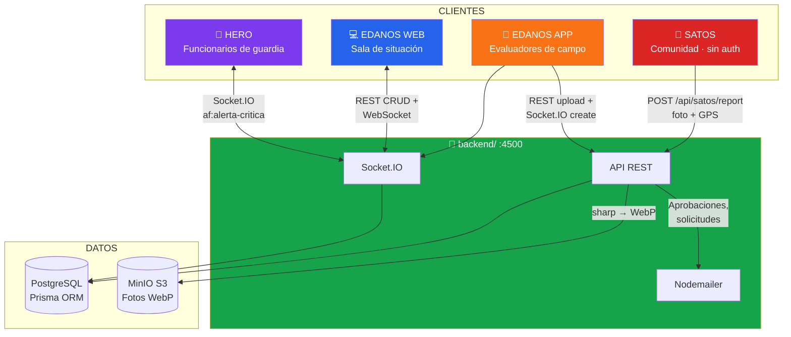
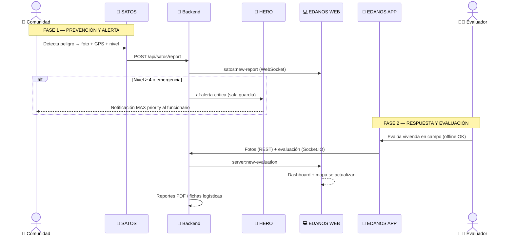
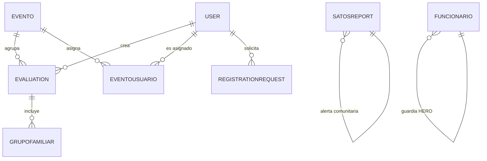

# 🚨 EDANOS — Sistema Integral de Gestión de Emergencias

<div align="center">

**Evaluación de Daños y Análisis de Necesidades (EDAN) para Protección Civil**
_Origen: Mérida, Venezuela • Desarrollo 100% nacional_

[](https://edanosapp.site)
[](./LICENSE)
[](https://nodejs.org)
[](https://react.dev)
[](https://expo.dev)
[](https://www.prisma.io)

[Los 5 subsistemas](#-los-5-subsistemas) • [Arquitectura](#-arquitectura-del-ecosistema) • [Inicio rápido](#-inicio-rápido) • [API](#-referencia-de-api) • [Contribuir](#-contribuir)

</div>

---

## 📋 Índice

- [¿Qué es EDANOS?](#-qué-es-edanos)
- [El problema que resuelve](#-el-problema-que-resuelve)
- [Los 5 subsistemas](#-los-5-subsistemas)
- [Arquitectura del ecosistema](#-arquitectura-del-ecosistema)
- [Ciclo de vida de una emergencia](#-ciclo-de-vida-de-una-emergencia)
- [Stack tecnológico](#️-stack-tecnológico)
- [Inicio rápido](#-inicio-rápido)
- [Estructura del monorepo](#-estructura-del-monorepo)
- [Referencia de API](#-referencia-de-api)
- [Base de datos](#-base-de-datos)
- [Seguridad](#-seguridad)
- [Variables de entorno](#-variables-de-entorno)
- [Contribuir](#-contribuir)
- [Licencia](#-licencia)

---

## 🎯 ¿Qué es EDANOS?

**EDANOS** es un ecosistema digital modular que moderniza la gestión de **Evaluaciones de Daños y Análisis de Necesidades (EDAN)** en Venezuela. Convierte el proceso tradicional de formularios en papel —lento, propenso a errores y perdido con facilidad en campo— en un sistema digital en tiempo real con capacidad **offline**, geolocalización, fotografías validadas y notificaciones instantáneas.

### Misión

Empoderar a los organismos de Protección Civil con una plataforma digital robusta y segura que permita una respuesta coordinada, inmediata y basada en evidencia.

### Visión

Constituirse como la herramienta tecnológica estándar de referencia nacional, garantizando independencia y eficacia en la administración de emergencias mediante soberanía tecnológica.

### Puntos clave

- ✅ **Offline-first**: las apps móviles capturan datos sin cobertura y sincronizan al recuperar señal
- ✅ **Tiempo real**: WebSockets (Socket.IO) propagan evaluaciones y alertas en menos de 5 segundos
- ✅ **Alerta ciudadana**: SATOS permite a la comunidad reportar con foto + GPS obligatorios
- ✅ **Escalamiento automático**: alertas críticas (nivel ≥ 4) notifican a funcionarios de guardia con prioridad máxima
- ✅ **Multi-institucional**: jerarquía estadal/municipal con roles y filtrado geográfico
- ✅ **Open source**: Licencia MIT, desarrollado con soberanía tecnológica

---

## 🔥 El problema que resuelve

Antes de EDANOS, la gestión de emergencias dependía de procesos analógicos:

| Situación anterior | Solución con EDANOS |
|---|---|
| 📝 Formularios en papel (mojados, ilegibles, perdidos) | Formularios digitales con firma y fotos |
| 🐌 Datos tardaban días en llegar a la oficina | Sincronización en tiempo real vía WebSocket |
| 📊 Imposible obtener estadísticas en vivo | Dashboard con métricas y gráficos automáticos |
| 🗺️ Sin visión geográfica de los daños | Mapa interactivo con marcadores y clústeres |
| 🔄 Duplicidad de evaluaciones por sector | Prevención de duplicados y eventos centralizados |
| 📉 Decisiones con información desactualizada | Reportes PDF y fichas técnicas generadas al instante |

> **Catalizador histórico**: las inundaciones y deslizamientos del eje del Páramo merideño (junio 2025) evidenciaron el colapso de la toma de datos en papel durante la Onda Tropical N°9.

---

## 📦 Los 5 subsistemas

El ecosistema se compone de **un núcleo central** y **cuatro aplicaciones cliente**, cada uno como carpeta independiente dentro del monorepo:

| # | Subsistema | Carpeta | Rol | Stack principal |
|---|---|---|---|---|
| 🧠 | **Backend** | `backend/` | API REST + WebSockets compartida (el cerebro) | Express 4 + Prisma 6 + PostgreSQL + Socket.IO |
| 📱 | **EDANOS APP** | `edan1.2/` | Evaluación de daños en campo | React Native 0.81 + Expo SDK 54 |
| 💻 | **EDANOS WEB** | `frontendpc/` | Plataforma administrativa / sala de situación | React 19 + Vite + Tailwind v4 |
| 📡 | **SATOS** | `satos/` | Alerta temprana comunitaria (crowdsourcing) | React Native 0.81 + Expo SDK 54 |
| 🚨 | **HERO** | `hero/` | Respuesta táctica de funcionarios de guardia | React Native 0.81 + Expo SDK 54 |

> **Nota sobre el ecosistema completo**: además de estos 5 subsistemas, existe **EDOS / EDANOS SCHOOL** (plataforma de capacitación e-learning con Angular + NestJS) como complemento educativo del ecosistema. No forma parte de este repositorio.

---

### 🧠 1. Backend — `backend/`

**El cerebro del ecosistema.** API REST central que todos los clientes consumen, con comunicación en tiempo real por WebSockets y almacenamiento de imágenes optimizadas.

**Identificación técnica:**

| Característica | Valor |
|---|---|
| Framework | Express.js 4.21 (ESM, `"type": "module"`) |
| ORM | Prisma 6.19 + PostgreSQL |
| Tiempo real | Socket.IO 4.8 |
| Puerto | `4500` (default) |
| Almacenamiento | MinIO compatible S3 (`@aws-sdk/client-s3`) |
| Autenticación | JWT (HS256) + cookies httpOnly + bcryptjs |
| Email | Nodemailer + Gmail SMTP |

**Características principales:**

- API RESTful completa organizada por dominios (`edan`, `eventos`, `usuarios`, `satos`, `funcionarios`, `registration-request`)
- Salas WebSocket geográficas e institucionales: `web`, `superadmin`, `estado:{codigo}`, `municipio:{codigo}`, `evento:{id}`, `funcionarios-guardia`
- Procesamiento de imágenes con **sharp**: fotos EDAN → WebP 1200px, fotos SATOS → WebP 800px
- Sistema **jerárquico de usuarios**: `user → coordinador → admin → superadmin` con cuentas estadales/municipales
- Solicitud de registro pública con aprobación por superadmin (envío de credenciales por email)
- Rate limiting en reportes SATOS: 10 reportes / 30 min por IP
- Scripts utilitarios: `seed.js` (datos de muestra), `ensureSuperadmin.js`, limpieza y migraciones

**Estructura:**

```
backend/
├── src/
│   ├── index.js              # Punto de entrada + CORS + rutas
│   ├── sockets.js            # Salas y eventos WebSocket
│   ├── controller/           # Lógica de negocio (edan, eventos, usuarios, satos, funcionarios, registration)
│   ├── routes/               # Rutas Express por dominio
│   ├── middleware/           # validartoken.js (JWT Bearer/cookie)
│   ├── services/             # email.service.js (Nodemailer)
│   ├── helpers/              # uploadSatosPhoto.js
│   ├── libs/                 # prisma.js, s3-client.js (MinIO), multer.js
│   └── utils/                # jwt.js, calificacion.js, generatePassword.js
├── prisma/
│   ├── schema.prisma         # Esquema completo de modelos
│   └── migrations/           # Migraciones SQL versionadas
├── scripts/                  # seed, ensureSuperadmin, utilidades
└── .env.example              # Plantilla de variables de entorno
```

---

### 📱 2. EDANOS APP — `edan1.2/`

**Aplicación móvil de campo** para evaluadores de Protección Civil. Captura la evaluación EDAN completa en zona sin cobertura y la sincroniza automáticamente.

**Identificación técnica:**

| Característica | Valor |
|---|---|
| Nombre | `edanos` (bundle: `com.osunapc.edanos`) |
| Framework | React Native 0.81.5 + Expo SDK 54 (New Architecture) |
| Lenguaje | TypeScript |
| Navegación | Expo Router (basado en archivos) + React Navigation |
| Almacenamiento | `expo-secure-store` (token) + `AsyncStorage` (datos) |
| Cámara / GPS | `expo-camera`, `expo-location`, `expo-image-picker` |
| Actualizaciones | OTA vía Expo Updates |

**Características principales:**

- 📋 Formulario EDAN completo: información preliminar, ubicación, coordenadas geográficas + UTM, uso de estructura, evento, jefe de calle, condición de vivienda, carga familiar dinámica, familia desalojada, afectaciones estructurales/no estructurales, líneas vitales, datos de evaluado y evaluador
- 📸 Captura de fotografías con cámara o galería
- 📍 Geolocalización GPS con fallback a coordenadas de Mérida
- ✍️ Firma digital del evaluador y del afectado (base64)
- 🎯 Selector de eventos activos (modal) para agrupar evaluaciones por desastre
- 📴 **Modo offline**: evaluaciones guardadas localmente con identificadores temporales; se sincronizan al recuperar red
- 🔑 Login con cédula + contraseña (JWT de 30 días)

**Flujo de envío de evaluación:**

```
1. Separar imágenes del FormData
2. Subir fotos: POST /api/edan/upload (REST) → URLs en MinIO
3. Fusionar URLs subidas con los datos del formulario
4. Enviar datos finales: Socket.IO (app:create-evaluation)
```

---

### 💻 3. EDANOS WEB — `frontendpc/`

**Plataforma administrativa y sala de situación.** Dashboard central donde coordinadores y directivos monitorean evaluaciones, eventos y alertas en tiempo real.

**Identificación técnica:**

| Característica | Valor |
|---|---|
| Nombre | EDANOS \| Protección Civil Mérida |
| Stack | React 19 + Vite + TypeScript + Tailwind CSS v4 |
| Estado global | Zustand |
| Tablas | TanStack Table |
| Gráficos | Recharts |
| Mapas | Leaflet + MarkerCluster (sin Google Maps) |
| PDF | pdfmake / @react-pdf/renderer |
| Tiempo real | socket.io-client |
| Deploy | Netlify (SPA) o Docker (nginx:alpine) |

**Rutas principales:**

| Ruta | Vista |
|---|---|
| `/` | Landing con datos reales |
| `/login` | Login (cédula + contraseña) |
| `/dashboard` | Estadísticas en tiempo real |
| `/evaluaciones` | Tabla completa con búsqueda, filtros y exportación |
| `/evaluaciones/:id` | Detalle de evaluación |
| `/crear-evaluacion` | Formulario web |
| `/eventos` | CRUD de eventos de emergencia |
| `/eventos/:id` | Detalle con evaluaciones asignadas |
| `/proyectos/*` | Páginas informativas del ecosistema |

**Características principales:**

- 📊 Dashboard con métricas clave y gráficos Recharts actualizados por WebSocket
- 🗺️ Mapa Leaflet con marcadores clusterizados y popups (foto + detalles)
- 📡 Panel SATOS: monitoreo de reportes comunitarios con mapa y alertas sonoras
- 📄 Generación de reportes PDF por evaluación y fichas técnicas de logística
- 🎛️ Gestión de eventos (crear, asignar evaluadores, cerrar, archivar)
- 👥 Gestión de usuarios jerárquica por seccionales con roles
- 🌙 Responsive + dark mode
- 🔍 SEO completo: Schema.org JSON-LD, Open Graph, sitemap.xml

---

### 📡 4. SATOS — `satos/`

**Sistema de Alerta Temprana Comunal.** Permite a cualquier ciudadano reportar una emergencia en tiempo real con validación visual, sin necesidad de registro.

**Identificación técnica:**

| Característica | Valor |
|---|---|
| Framework | React Native 0.81.5 + Expo SDK 54 |
| Navegación | Expo Router |
| Autenticación | ❌ Ninguna (cero fricción en emergencias) |
| Validación | 📸 Foto obligatoria + 📍 GPS obligatorio |
| Endpoint | `POST /api/satos/report` (público, con rate limit) |

**Flujo de uso:**

```
1. Abrir app → botón circular ROJO grande
2. Tocar botón → pantalla de selección de nivel (1-5)
3. Seleccionar nivel → cámara completa → capturar foto
4. Enviar automáticamente (foto + GPS + nivel + comentario)
```

**Niveles de riesgo:**

| Nivel | Comportamiento |
|---|---|
| 1 – 3 | Se registra y aparece en el dashboard web |
| 4 – 5 o `emergency=true` | **Escalamiento automático**: notificación crítica a HERO + dashboard web |

**Características:**

- 🚫 Sin login ni registro (prioriza velocidad en emergencia)
- 📸 Foto obligatoria: reportes sin imagen no se consideran válidos (evita imágenes precargadas)
- 📍 Coordenadas GPS con fallback a `8.595245, -71.14444` (Mérida)
- 🛡️ Rate limit: 10 reportes cada 30 minutos por IP
- 🖼️ Foto optimizada: resize 800px → WebP calidad 75 → MinIO

---

### 🚨 5. HERO — `hero/`

**Sistema de Respuesta Táctica para funcionarios de guardia.** Recibe notificaciones de máxima prioridad que saltan las restricciones de "no molestar" cuando SATOS detecta una alerta crítica.

**Identificación técnica:**

| Característica | Valor |
|---|---|
| Paquete Android | `com.pcmerida.hero` |
| Framework | React Native 0.81.5 + Expo SDK 54 |
| Notificaciones | `expo-notifications` (prioridad MAX) |
| Segundo plano | `expo-background-fetch` + `expo-task-manager` |
| Tiempo real | socket.io-client con reconexión automática |
| Autenticación | Email + contraseña (`POST /api/funcionarios/login`) — tabla `Funcionario` independiente |

**Pantallas:**

- `/login` — Credenciales de funcionario (debe estar `activo=true`)
- `/` — Dashboard de guardia: badge CMD, indicador EN LÍNEA/OFFLINE, toggle "MODO GUARDIA", canal de alertas críticas

**Estética**: militar/cyberpunk — fondo `#0f172a`, acentos `#ff6600`.

**Flujo crítico SATOS → HERO:**

```
1. Ciudadano reporta en SATOS (nivel 4-5 o emergency=true)
2. Backend recibe POST /api/satos/report
3. Backend emite: internal:trigger-alert-officials
4. sockets.js re-emite como af:alerta-critica → sala "funcionarios-guardia"
5. HERO recibe el evento → NotificationService.showCriticalAlert()
6. Notificación MAX priority con vibración [0,250,250,250] e información del reporte
```

**Características:**

- 🔔 Notificaciones locales de prioridad máxima (canal `emergency-alerts`, importancia MAX)
- 📡 Se une a la sala `funcionarios-guardia` vía Socket.IO (handshake con JWT)
- 🔋 Tarea en segundo plano cada 60s (background fetch)
- 🎯 Payload de alerta: `reporteId`, `lat`, `lng`, nivel y comentario
- ⏳ Token JWT de 7 días, almacenado en AsyncStorage (`hero_token`, `hero_user`)

---

## 🏗️ Arquitectura del ecosistema



### Salas WebSocket

| Sala | Propósito |
|---|---|
| `web` | Clientes del dashboard |
| `superadmin` | Superadministradores |
| `estado:{codigo}` / `municipio:{codigo}` | Filtrado geográfico jerárquico |
| `institucion:{tipo}` | Filtrado por institución |
| `evento:{id}` | Suscripción a un evento específico |
| `funcionarios-guardia` | Funcionarios activos en HERO |

### Principios de diseño

- **Arquitectura modular distribuida**: cada subsistema opera independiente pero comunicado con el núcleo
- **Backend como único punto de verdad**: todos los clientes convergen en `backend/`
- **Offline-first en campo**: la app móvil nunca depende de la red para capturar
- **Patrón public/subscriber por geografía**: eventos de emergencia se propagan solo a jurisdicciones relevantes
- **Multitenancy suave**: sistema jerárquico estadal/municipal con códigos (`ESTADO`, `ESTADO-MUNICIPIO`)

---

## 🔄 Ciclo de vida de una emergencia



---

## 🛠️ Stack tecnológico

| Capa | Tecnologías |
|---|---|
| **Backend** | Node.js 18+, Express 4, Prisma 6, PostgreSQL, Socket.IO 4, JWT, bcryptjs, sharp, MinIO (AWS SDK v3), Nodemailer, multer, express-rate-limit |
| **EDANOS APP** | React Native 0.81, Expo SDK 54, TypeScript, Expo Router, expo-camera, expo-location, expo-secure-store, AsyncStorage |
| **EDANOS WEB** | React 19, Vite, TypeScript, Tailwind CSS v4, Zustand, TanStack Table, Recharts, Leaflet, pdfmake, socket.io-client |
| **SATOS** | React Native 0.81, Expo SDK 54, Expo Router, expo-camera, expo-location |
| **HERO** | React Native 0.81, Expo SDK 54, expo-notifications, expo-background-fetch, socket.io-client |
| **Infraestructura** | PostgreSQL, MinIO (S3), Docker, Netlify (frontend), Gmail SMTP |

---

## 🚀 Inicio rápido

### Requisitos

- **Node.js 18+** y npm
- **PostgreSQL 14+** (o cadena de conexión Prisma compatible)
- **Git**
- Para móviles: Expo Go o emulador Android/iOS
- (Opcional) MinIO o bucket S3 para fotos

### 1. Clonar

```bash
git clone https://github.com/osunapc/edanos-app.git
cd edanos-app
```

### 2. Backend (obligatorio — todos los clientes lo necesitan)

```bash
cd backend
npm install

# Configurar variables de entorno
cp .env.example .env
# Edita .env: DATABASE_URL, JWT_SECRET_KEY, MinIO, email, etc.

# Migrar base de datos
npx prisma migrate dev
npx prisma generate

# Sembrar datos de muestra (opcional)
npm run seed

# Iniciar (puerto 4500)
npm run dev
```

### 3. EDANOS WEB

```bash
cd frontendpc
npm install

# Configurar URL de la API
cp .env.example .env
# Edita VITE_API_URL (default: http://localhost:4500)

npm run dev
```

### 4. EDANOS APP (móvil)

```bash
cd edan1.2
npm install

# La API_URL está en edan1.2/confg/constants.ts
# (por defecto apunta a producción; cámbiala a http://<tu-ip>:4500 para desarrollo)

npx expo start
```

### 5. SATOS (móvil)

```bash
cd satos
npm install

# La URL del reporte está en satos/app/report.tsx
npx expo start
```

### 6. HERO (móvil)

```bash
cd hero
npm install

# La API_URL está en hero/src/constants/config.ts
npx expo start
```

---

## 📁 Estructura del monorepo

```
edanos-app/
├── backend/                 # 🧠 API REST + Socket.IO (el cerebro)
│   ├── src/
│   ├── prisma/
│   │   ├── schema.prisma
│   │   └── migrations/
│   ├── scripts/
│   └── .env.example
│
├── frontendpc/              # 💻 EDANOS WEB (React + Vite)
│   ├── src/
│   │   ├── pages/           # Rutas/vistas
│   │   ├── components/      # Componentes UI
│   │   ├── store/           # Estado global (Zustand)
│   │   ├── services/        # Cliente API + sockets
│   │   └── confg/           # Configuración (API_URL)
│   └── .env.example
│
├── edan1.2/                 # 📱 EDANOS APP (Expo)
│   ├── app/                 # Pantallas (Expo Router)
│   ├── components/
│   ├── services/            # evaluationService, socketService
│   ├── hooks/
│   ├── context/
│   └── confg/               # constants.ts (API_URL, claves)
│
├── satos/                   # 📡 SATOS (Expo)
│   ├── app/                 # report.tsx, pantallas
│   └── constants/
│
├── hero/                    # 🚨 HERO (Expo)
│   └── src/
│       ├── constants/       # Config.ts (API_URL)
│       ├── services/        # NotificationService, BackgroundService, api.service
│       ├── context/         # AuthContext
│       └── hooks/
│
├── README.md                # Este archivo
├── CONTRIBUTING.md          # Guía de contribución
├── AGENTS.md                # Guías para agentes de código
└── LICENSE                  # Licencia MIT
```

---

## 🔌 Referencia de API

> Base URL por defecto: `http://localhost:4500`

### 👤 Usuarios — `/api/usuarios`

| Método | Ruta | Descripción | Auth |
|---|---|---|---|
| POST | `/api/usuarios/login` | Login web (cookie httpOnly) | ❌ |
| POST | `/api/usuarios/loginMovil` | Login móvil (JWT en JSON) | ❌ |
| POST | `/api/usuarios/registro` | Registro (valida jerarquía) | ❌ |
| GET | `/api/usuarios` | Lista usuarios (filtro jerárquico) | ✅ |
| GET | `/api/usuarios/:id` | Usuario por ID | ❌ |
| GET | `/api/usuariosCedula/:ci` | Usuario por cédula | ❌ |
| GET | `/api/verifyToken` | Verifica token (Bearer o cookie) | — |
| PATCH | `/api/usuarios/:id` | Actualizar usuario | ✅ |
| DELETE | `/api/usuarios/:id` | Eliminar usuario | ✅ |
| POST | `/api/usuarios/logout` | Limpiar cookie | — |

### 📋 Evaluaciones EDAN — `/api/edan`

| Método | Ruta | Descripción | Auth |
|---|---|---|---|
| GET | `/api/edan` | Lista (filtro por rol + `eventoId`) | ✅ |
| GET | `/api/edan/:id` | Detalle con grupo familiar | ✅ |
| POST | `/api/edan` | Crear evaluación | ✅ |
| POST | `/api/edan/upload` | Subir fotos (multipart, 15MB máx.) | ✅ |
| PUT | `/api/edan/:id` | Actualizar | ✅ |
| DELETE | `/api/edan/:id` | Eliminar | ✅ |

### 🌋 Eventos — `/api/eventos`

| Método | Ruta | Descripción |
|---|---|---|
| GET | `/api/eventos/` | Lista (filtro jurisdiccional) |
| GET | `/api/eventos/activos` | Solo activos |
| POST | `/api/eventos/` | Crear evento |
| POST | `/api/eventos/asignar` | Asignar evaluador |
| PUT | `/api/eventos/:id/cerrar` | Cerrar (transacción) |
| PUT | `/api/eventos/:id/archivar` | Archivar (superadmin) |
| POST | `/api/eventos/validar-codigo` | Validar código de evento |

### 📡 SATOS — `/api/satos`

| Método | Ruta | Descripción | Auth |
|---|---|---|---|
| POST | `/api/satos/report` | Crear reporte (foto obligatoria, rate-limit) | ❌ |
| GET | `/api/satos/reports` | Lista paginada | ✅ |
| PUT | `/api/satos/reports/:id/close` | Cerrar reporte | ✅ |
| PUT | `/api/satos/reports/:id/validate` | Validar reporte | ✅ |

### 🚨 Funcionarios (HERO) — `/api/funcionarios`

| Método | Ruta | Descripción |
|---|---|---|
| POST | `/api/funcionarios/login` | Login (email + contraseña, debe estar activo) |
| GET | `/api/funcionarios/me` | Perfil |
| GET | `/api/funcionarios/activos` | En guardia |
| PUT | `/api/funcionarios/guardia` | Toggle guardia |

### 📝 Registro público — `/api/registration-request`

| Método | Ruta | Descripción |
|---|---|---|
| POST | `/api/registration-request` | Crear solicitud (público) |
| POST | `/api/registration-request/upload-carta` | Subir carta formal (PDF/imagen) |
| GET | `/api/registration-requests` | Todas (superadmin) |
| PUT | `/api/registration-requests/:id/approve` | Aprobar (crea usuario + email) |
| PUT | `/api/registration-requests/:id/reject` | Rechazar con motivo |

### 🔌 Eventos WebSocket

**Cliente → servidor:**

```javascript
socket.emit('join-evento', { eventoId })
socket.emit('leave-evento', { eventoId })
socket.emit('app:create-evaluation', data)
socket.emit('app:update-evaluation', data)
socket.emit('app:delete-evaluation', { id })
```

**Servidor → cliente:**

```javascript
socket.on('server:new-evaluation', data => { /* ... */ })
socket.on('server:evaluation-updated', data => { /* ... */ })
socket.on('satos:new-report', report => { /* ... */ })
socket.on('af:alerta-critica', alerta => { /* ... */ })  // HERO
socket.on('server:nuevo-evento', evento => { /* ... */ })
```

---

## 🗄️ Base de datos

Modelos principales (Prisma + PostgreSQL):



| Modelo | Descripción |
|---|---|
| `User` | Usuarios jerárquicos: roles `user/coordinador/admin/superadmin`, cédula única, códigos estadal/municipal |
| `Evaluation` | Evaluación EDAN (~70 campos): ubicación, coordenadas UTM, vivienda, familia, afectaciones, firmas, fotos |
| `GrupoFamiliar` | Miembros del grupo familiar (cascade desde Evaluation) |
| `Evento` | Evento de emergencia: código único (`MER-001`), municipios, estado (`activo/cerrado/archivado`) |
| `EventoUsuario` | Puente evento ↔ evaluador asignado |
| `SatosReport` | Reporte comunitario: lat/lng, nivel 1-5, `emergency`, `photoUrl`, validación |
| `Funcionario` | Tabla independiente para HERO: `activo` (de guardia), `socketId` |
| `RegistrationRequest` | Solicitud pública de registro con carta PDF y aprobación |

> El esquema completo está en [`backend/prisma/schema.prisma`](./backend/prisma/schema.prisma).

---

## 🔒 Seguridad

- **JWT HS256**: usuarios 30 días · funcionarios 7 días
- **Cookies httpOnly** con `secure` + `sameSite=None` en producción
- **bcryptjs** (salt 10) para contraseñas
- **CORS con whitelist** estricta (dominio de producción, frontend y localhost)
- **Rate limiting**: 10 reportes SATOS / 30 min por IP
- **Fotos validadas**: SATOS exige imagen fresca tomada con la app (bloquea precargadas)
- **Filtrado geográfico por rol**: superadmin ve todo, admin por estado, coordinador por municipio
- **`ensureSuperadmin()`**: upsert del superadmin en cada arranque

---

## ⚙️ Variables de entorno

Copia `backend/.env.example` → `backend/.env` y completa:

| Variable | Descripción |
|---|---|
| `DATABASE_URL` | Cadena de conexión PostgreSQL (o Prisma Accelerate) |
| `JWT_SECRET_KEY` | Secreto para firmar tokens (¡genera uno propio!) |
| `MINIO_ENDPOINT` / `MINIO_ACCESS_KEY` / `MINIO_SECRET_KEY` / `MINIO_BUCKET_NAME` | Almacenamiento S3 compatible |
| `EMAIL_USER` / `EMAIL_PASSWORD` | Cuenta Gmail + App Password de 16 caracteres |
| `SUPERADMIN_EMAIL` / `SUPERADMIN_PASSWORD` | Credenciales del superadmin inicial |
| `FRONTEND_URL` | URL del frontend (links en emails) |
| `PORT` | Puerto del servidor (default `4500`) |

Frontend (`frontendpc/.env`):

| Variable | Descripción |
|---|---|
| `VITE_API_URL` | URL del backend (default `http://localhost:4500`) |

**Nunca subas archivos `.env` al repositorio.** Todos los `.env` reales están excluidos por `.gitignore`.

---

## 📡 Sincronización de este monorepo

Este repositorio se publica como monorepo open source a partir de los proyectos de desarrollo individuales. Para mantenerlo actualizado:

```powershell
# Desde la carpeta de desarrollo, ejecuta el script de sincronización:
D:\proyectos2025\edanosapp\sync.ps1

# Revisa lo que cambió, haz commit y sube:
git -C D:\proyectos2025\edanosapp add -A
git -C D:\proyectos2025\edanosapp commit -m "docs: actualización del sistema"
git -C D:\proyectos2025\edanosapp push
```

El script copia `backend/`, `frontendpc/`, `edan1.2/`, `satos/`, `hero/` y los archivos raíz, excluyendo siempre credenciales (`.env`), dependencias y artefactos locales.

---

## 🤝 Contribuir

¡Las contribuciones son bienvenidas! Lee [CONTRIBUTING.md](./CONTRIBUTING.md) para las guías completas.

### Flujo resumido

1. **Fork** del repositorio
2. Rama: `git checkout -b feature/mi-mejora`
3. Cambios siguiendo las guías de estilo del proyecto
4. `npm run lint` en el subsistema afectado
5. Commit convencional: `feat(mobile): descripcion`
6. Push + Pull Request descriptivo

### Tips

- **JavaScript/TypeScript**: comillas simples, punto y coma, indentación 2 espacios (backend usa tabs de 4)
- **Commits**: [Conventional Commits](https://www.conventionalcommits.org/)
- **Issues**: reporta bugs con pasos de reproducción y entorno

---

## 👨‍💻 Autor

**Gabriel Osuna** — Desarrollador de software y ex-funcionario de Protección Civil Mérida.

- GitHub: [github.com/osunapc](https://github.com/osunapc)
- Proyecto: [edanosapp.site](https://edanosapp.site)

_Proyecto ideado y desarrollado desde cero combinando experiencia técnica con conocimiento de los procesos de gestión de emergencias._

---

## 📜 Licencia

Este proyecto está bajo la **Licencia MIT** — ver [LICENSE](./LICENSE).

Se solicita mantener la atribución al autor original al utilizar, modificar o distribuir el software.

---

<div align="center">

**⚡ Desarrollado con pasión para Venezuela ⚡**

_Modernizando la gestión de emergencias en todo el país_

</div>
